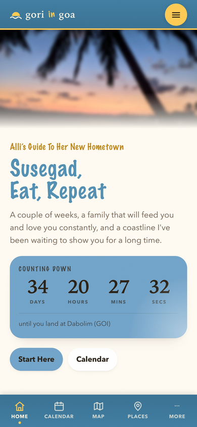

# GORI in GOA

An orientation site for one visitor, in particular. Nine pages, no build step, no accounts, works on a phone with no signal once it's loaded.

**Live at:** https://sc-mdsouza.github.io/gori-in-goa/

Open **`index.html`** to start, or just use the link above.



---

## The short version

| Page | File | What it's for |
|---|---|---|
| Home | `index.html` | The welcome and the countdown to her flight |
| Guide | `guide.html` | How the site works, the packing checklist, 20 how-tos, Konkani phrases |
| Our Home | `home.html` | The house, the kitchen, the house rules |
| Calendar | `calendar.html` | Every event, in a month grid and a flat list, plus a `.ics` download |
| Map | `map.html` | Illustrated map with every place pinned |
| Places | `places.html` | Restaurants, cafés, sunsets, drives, gaddo — filterable |
| Beaches | `beaches.html` | Which to swim in, which to look at |
| Family | `family.html` | Who's who, household by household |
| Photo credits | `credits.html` | Where the photograph came from, and what is original |

Everything else is `assets/css/style.css` (the look), `js/shell.js` (nav, menu, bottom bar) and one file per page in `js/`.

---

## Editing it

**All the content lives in one file: `js/data.js`.** Change a date, a place, a name or a phone number there, save, refresh the browser. Nothing to rebuild.

### 1. The dates

At the top of `js/data.js`:

```js
trip: {
  arrivalISO: "2026-12-18T07:00:00+05:30",
  departureISO: "2027-01-04T21:00:00+05:30",
  arrivalPlaceholder: false,  // true brings back the "flight not booked" note
  ...
}
```

`arrivalISO` drives the countdown on the home page. Keep the `+05:30` (India time) at the end. The departure date is still my guess — change it when you know her return flight, and the countdown will start counting the other way.

### 2. Events

Each event is one block in the `events` list:

```js
{ date: "2026-12-22", time: "18:00", title: "Wedding — Ana & Rohan",
  cat: "wedding", place: "St. Xavier's, Benaulim",
  note: "We leave at 5. It will not start at 6." }
```

- `date` is `YYYY-MM-DD`. `time` is 24-hour, or `""` for all day.
- `cat` picks the colour: `travel`, `family`, `wedding`, `beach`, `sunset`, `trip`, `celebration`, `free`.
- Remove `draft: true` once the details are real — that's what shows the "details to confirm" pill.

The calendar, the "up next" list on the home page, and the `.ics` export all read from this one list.

### 3. Places on the map

Every place has a pin position:

```js
{ id: "martins", name: "Martin's Corner", cat: "restaurant", area: "Betalbatim",
  blurb: "...", tags: ["Goan", "Dinner"],
  map: { x: 278, y: 330 } }
```

`x` runs 0–1000 left to right, `y` runs 0–1240 top to bottom. The sea is roughly left of `x: 200`; Palolem is near `x: 180, y: 1010`; Margao is near `x: 520, y: 400`. If a pin looks wrong, nudge the numbers — that's the whole system.

`cat` is one of `restaurant` (blue), `cafe` (gold), `dessert` (clay), `cocktail` (deep blue), `sunset` (orange), `drive` (pale blue), `gaddo` (deep cream). Adding a place automatically gives it a pin, a card on Places, and an entry in the map's list.

`topPick: true` gives a place the gold **Mitchelle's top Picks** badge and its own filter. `top50: 6` marks it as No. 6 on India's Top 50 list — it gets a rank badge, appears in the ranked table on the Places page and in the "India's Top 50" filter:

```js
{ id: "izumi", name: "Izumi Assagao", cat: "restaurant", area: "Assagao", top50: 6, ... }
```

`topPick: true` on any place also gives it a filter of its own:

```js
{ id: "martins", name: "Martin's Corner", ... , topPick: true }
```

### 4. The family

The page is built from `familyGroups` — one block per household, each with its own members:

```js
{ name: "The Dias's", note: "Mervin's sister, Myola", members: [
  { name: "Myola", role: "Aunt" },
  { name: "Jovi",  role: "Son" },
  { name: "Ari",   role: "Son", note: "Jovi & Kivy's boy" },
]}
```

- `name` is the household heading; `note` is the small line beside it (how they connect).
- Each member needs `name` and `role`. An optional `note` adds a line under the role.
- Phone numbers are deliberately left off this page, so no Call / WhatsApp buttons show. If you ever want them, add `phone: "+91…"` to a member and the buttons appear on their own.

Five households are in there now: the D'Souza's, the other D'Souza's, the Dias's, the Gomes and the Fernandes.

### 5. Everything else

Same pattern in `js/data.js`: `dishes` (the kitchen), `beaches`, `checklist` (before-you-fly items), `howtos` (the accordions), `phrases`.

---

## Photographs

The photograph at the top of the page is **your own** — `PXL_20220111`, the palm against the sunset. It's blurred lightly (13px) and saved as `assets/img/photos/hero-dusk-wide.jpg` (1600×921).

It runs full-bleed across the top of the hero and fades into the paper with a mask, so it reads as a photograph dissolving into the page rather than a framed card. The text sits below the fade, on plain paper, where it stays crisp.

To swap it, replace that file with another landscape shot — or send it to me and I'll crop and blur it the same way.

**On Mario Miranda:** no Miranda artwork is reproduced here — it's still in copyright, and a gift site is a bad place to start a licensing problem. The map, the house, the beach strips, the little half-sun in the wordmark and the app icon are original drawings made in that hand-drawn Goan spirit. If you own prints or licence his images, they'd drop into the same photo slot.

---

## What's still a placeholder

Be honest with yourself about these before you send it:

- **Departure date** — I kept 4 Jan. Her landing (18 Dec, 7am) is real.
- **Wedding + ball details** — Melroy & Maria's Roce (25 Dec), the wedding (26 Dec), the Christmas Ball (24 Dec) and the New Year Ball (31 Dec) are in, but the venues and times are still `[venue]` and marked as draft.
- **Desserts and cocktails** — the Margao sweet shops and the two cocktail entries are still prompts marked *to confirm*. The café picks are yours now, but they have no descriptions yet.
- **Places** — the restaurant/sunset/drive/gaddo list is a sensible first draft from well-known South Goa spots, but it should be *your* list. Delete anything you wouldn't actually take her to.
- **Photos** — the hero background is your own dusk shot, but the photo slots on Our Home are still empty.

Anything with `draft: true` in `js/data.js` renders a small "to confirm" tag, so you can find the gaps by searching the file for `draft`.

---

## Putting it on her phone

**Quickest:** AirDrop the `gori-in-goa` folder to her, open `index.html` in Safari. Works offline, straight from Files.

**Better:** host it, so she can add it to her home screen like an app (and so you can keep editing it after she leaves).

1. Go to [app.netlify.com/drop](https://app.netlify.com/drop)
2. Drag the whole `gori-in-goa` folder onto the page
3. You get a URL in about ten seconds — rename it under Site settings

Then on her phone: open the URL in Safari → Share → **Add to Home Screen**. It gets the little sun icon, opens full-screen, and the countdown keeps ticking.

GitHub Pages or Vercel work the same way; there's no build command and no dependencies.

---

## Notes for the curious

- **No frameworks, no build, no dependencies.** Plain HTML, CSS and JavaScript. It'll still open in five years.
- **Mobile-first**, designed at 390px wide and checked up to desktop.
- **Look and feel:** soft, round, no hard outlines. Cards and buttons float on warm cream paper with gentle shadows; the nav is a sea-blue band with a gold trim and gold active states, and blue and gold carry the colour throughout, and orange is kept for sunset pins, the "in" in the wordmark and small moments only. The wordmark is lowercase with a half-sun-over-water mark, and the hero headline is set in Marker Felt — playful, and already on her phone.
- **Palette**: `#FF933E` orange, `#FFCB56` gold, `#FFE9A9` cream, `#73A5CA` blue — the Color Hunt set you sent, with tints and shades derived from it.
- **The checklist saves itself** in the browser's local storage, so ticks survive closing the tab.
- **The countdown** runs on her device's clock, in India time.
- **The `.ics` button** downloads the whole calendar so she can have it in Apple Calendar / Google Calendar offline. On iPhone this sometimes opens in a new tab instead of downloading — if so, use "Add All to Calendar" from the share sheet.
- **The map is a drawing, not a navigation tool.** Every pin has an "Open in Maps" button that hands the real address to her phone.

Made for one person, in particular. Goa, December.
